<p align="center">
  
</p>

<h1 align="center">Atlas</h1>

<p align="center">
  Free, self-paced security pathways for product designers.<br>
  Pick one at a time: a 60-day identity and security course, Security+ for Product Designers, or a short course on AI security.
</p>

<p align="center">
  <a href="https://marva-a.github.io/atlas/"><strong>Open Atlas</strong></a>
</p>

<p align="center">
  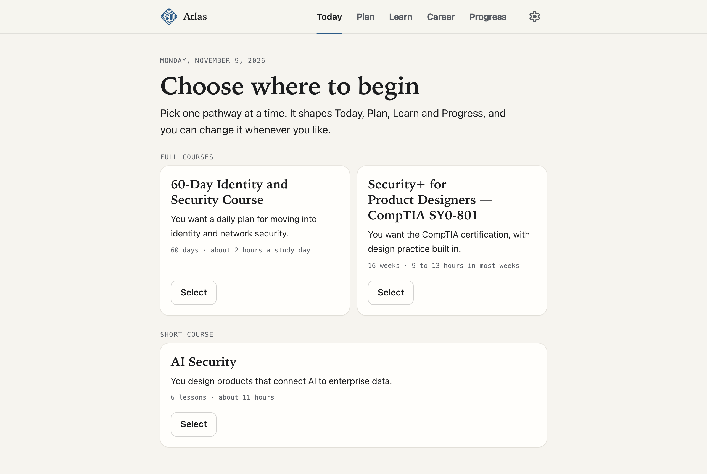
</p>

## What it is

Atlas is a study coach for product designers who want to work confidently in security, whether that means moving to a company that builds identity, network or cloud security products, or earning a certification.

Lessons start from the basics in plain language with everyday examples, then climb to intermediate and advanced topics.

Most lessons also show the idea as a small visual: a step-by-step flow, a side-by-side comparison, nested layers or a scale. They are made of real text, so they stay sharp, follow dark mode, stack on a phone and can be read aloud. One "Hide visuals" button turns them all off, and every visual repeats something the lesson already says in words.

The Security+ pathway also has 23 illustrations for its hardest ideas, such as the TLS handshake, a DNS lookup, salted password hashes, digital signatures, SQL injection, and RPO and RTO on one timeline. Each one has a full written description for people who cannot see it.

You can also select any words in a lesson and add a note, such as "Review again". The words stay highlighted, and Learn → Notes lists every note with a link back to its exact sentence. Notes are saved on your device with the rest of your progress.

The same selection can become a flashcard: Atlas fills in a question and answer in the style of the lesson's own cards, such as "What does 'Symmetric encryption' mean?", and you can edit both sides before saving. Each Security+ lesson also offers a card for every key term, with one button to add them all.

## Choosing a pathway

You work on **one pathway at a time**, and it shapes the whole app. Today shows your next step, Plan shows your schedule or week-by-week outline, and Learn, Lessons and Progress follow the pathway you chose.

| State | What it means |
| --- | --- |
| **Selected** | You have picked it but not begun. You can start it or unselect it. |
| **In progress** | You have started. Today and the other pages now follow this pathway. |
| **Paused** | You left it or switched away. Your progress stays saved, so you can pick it up later. |
| **Complete** | You have finished every lesson. |

<p align="center">
  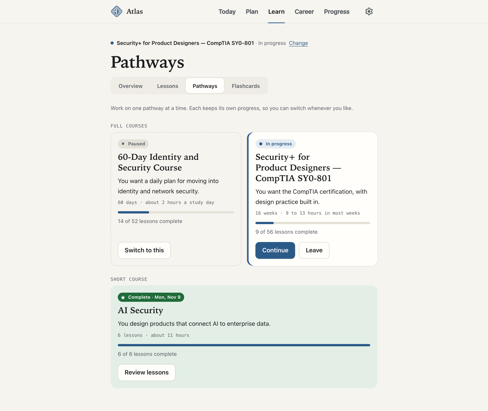
</p>

<table>
  <tr>
    <td width="50%">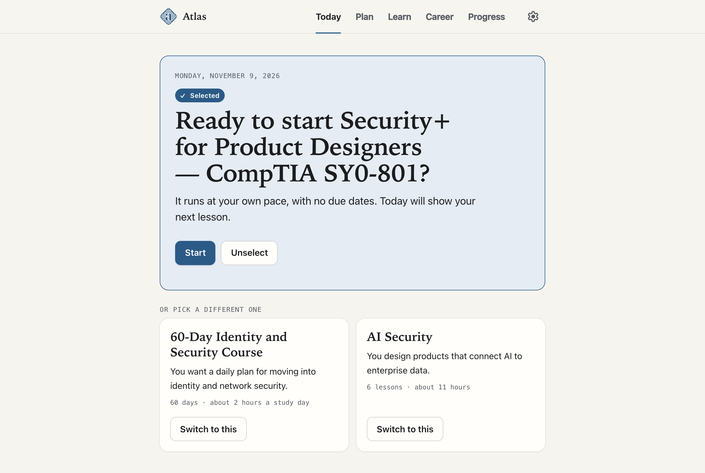</td>
    <td width="50%">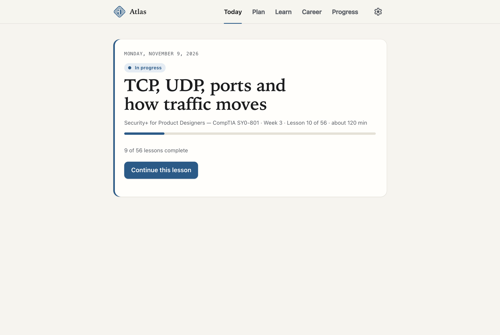</td>
  </tr>
  <tr>
    <td>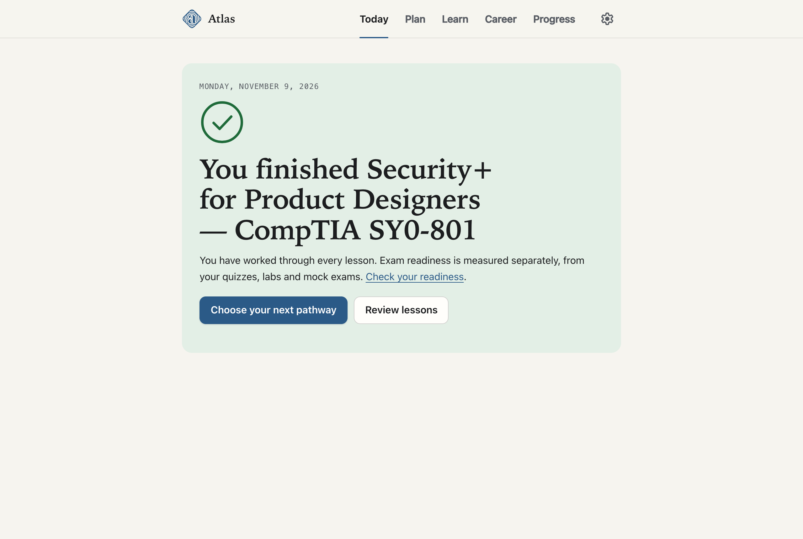</td>
    <td align="center">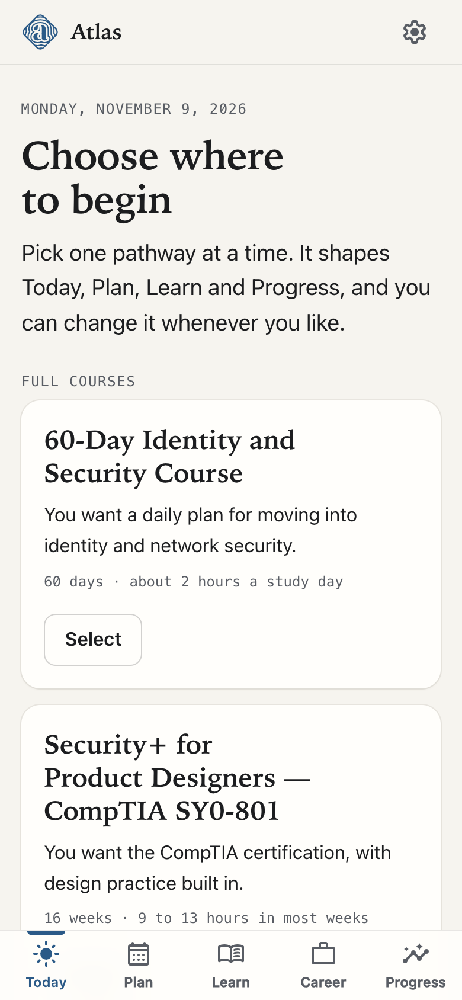</td>
  </tr>
</table>

| Pathway | Length | Best if |
| --- | --- | --- |
| **[60-Day Identity and Security Course](#the-60-day-course)** | 60 days on a calendar, about 2 hours a study day | You want a daily plan and a portfolio for moving into identity and network security. |
| **[Security+ for Product Designers](#security-for-product-designers--comptia-sy0-801)** | 16 weeks, self-paced, about 173 hours | You want the CompTIA certification, with design practice built in. |
| **[AI Security](#ai-security)** | 6 lessons, about 11 hours | You design products that connect AI to enterprise data. |

## The pathways

### The 60-day course

A calendar course with every lesson labelled **Basics**, **Intermediate** or **Advanced**. Starting it makes today Day 1. If you leave and come back, it resumes at your first unfinished lesson.

| Week | Topic |
| --- | --- |
| 1 | Identity basics and the people you design for, with security foundations: what security protects, risk decisions, controls and safe defaults |
| 2 | How networks work, explained for designers, with security foundations: clients, servers and APIs, protecting data, application security, a threat model |
| 3 | Zero trust and identity-based access |
| 4 | Sign-in, SSO and accounts at work |
| 5 | Containers and Kubernetes security |
| 6 | Seeing and responding: logs, alerts and incidents |
| 7 | Enterprise trust: least privilege, governance and policy as code |
| 8 | Machine identities, AI agents and designing for safety |
| 9 | Capstone: two case studies and your story |

- **52 lessons**, one for each study day, each with a measurable "by the end, you can" objective, key ideas, key terms, timed steps, and check-yourself questions with example answers. Security foundations are built into the Week 1–2 lessons that rely on them, so those weeks run longer than later ones.
- **17 designer exercises**: teardowns, flows, research, tabletop incidents and prototypes, using real tools such as Tailscale, Keycloak, Kubernetes and Calico.
- **Two portfolio case studies**: an access policy editor that shows who can reach what before a change goes live, and a Kubernetes flow from observed traffic to a recommended policy, staged before it is enforced.
- **Over 170 references** from primary sources (Kubernetes, Calico, Tailscale, NIST, OWASP, CISA, MITRE, Nielsen Norman Group and others). Every link is opened and checked before it is added.
- **Flashcards** with spaced repetition that unlock the day after their topic is taught.

<table>
  <tr>
    <td width="50%">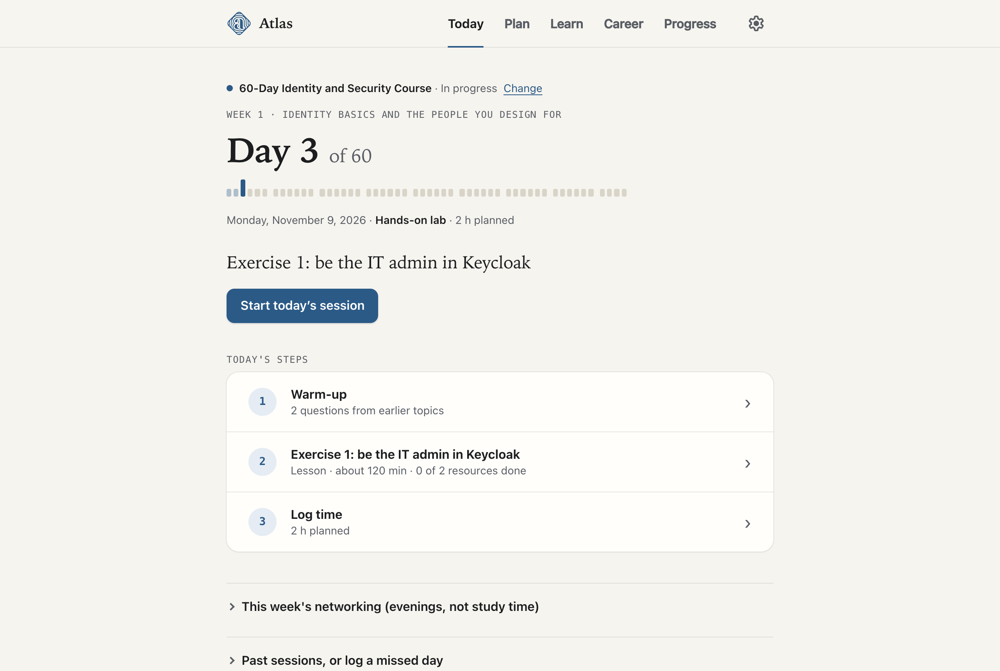</td>
    <td width="50%">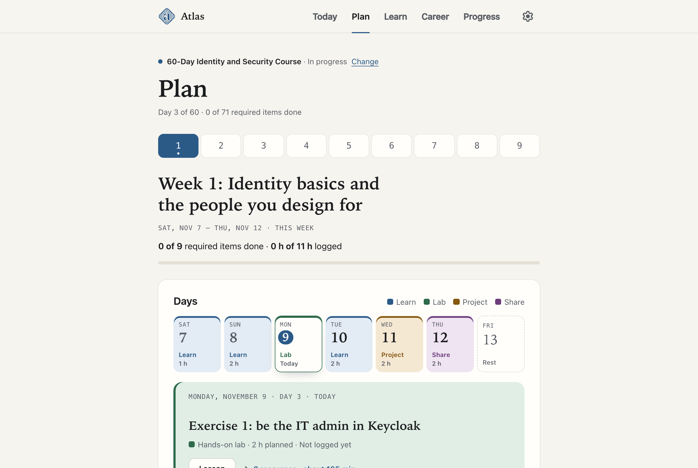</td>
  </tr>
  <tr>
    <td>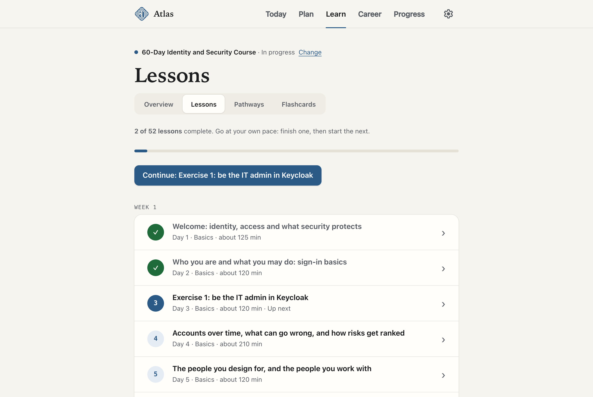</td>
    <td align="center">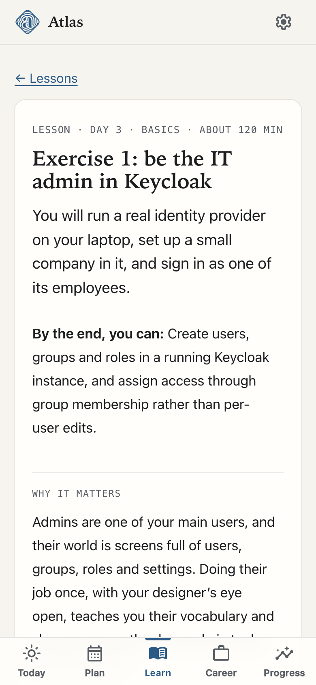</td>
  </tr>
</table>

### Security+ for Product Designers — CompTIA SY0-801

One 16-week pathway in seven modules, with two outcomes that are measured separately and never combined: readiness for the Security+ exam, and the ability to apply security knowledge as a product designer. Completing a design exercise never raises technical mastery, and passing a quiz never raises design competency.

- **All 27 exam objectives and all 5 domains**, after a 4-week foundation in computers, networks and protocols for people with no IT background.
- **56 lessons** that each move through the concept, a technical deep dive, real products, design application, separate technical and design checks, then review and references.
- **56 hands-on labs**, limited to systems you own or authorized practice environments.
- **255 knowledge-check questions, 12 performance-based questions and 2 timed mock exams.**
- **27 design exercises** (24 inside lessons and 3 case studies), each with a brief, constraints, deliverable, evaluation criteria and what to ask engineering, security and product. Lessons are labelled honestly as direct, cross-functional or foundational, so no exercise is forced.
- **178 references and 7 cheat sheets.** Everything needed is free, with no paid course, textbook or subscription required.

<p align="center">
  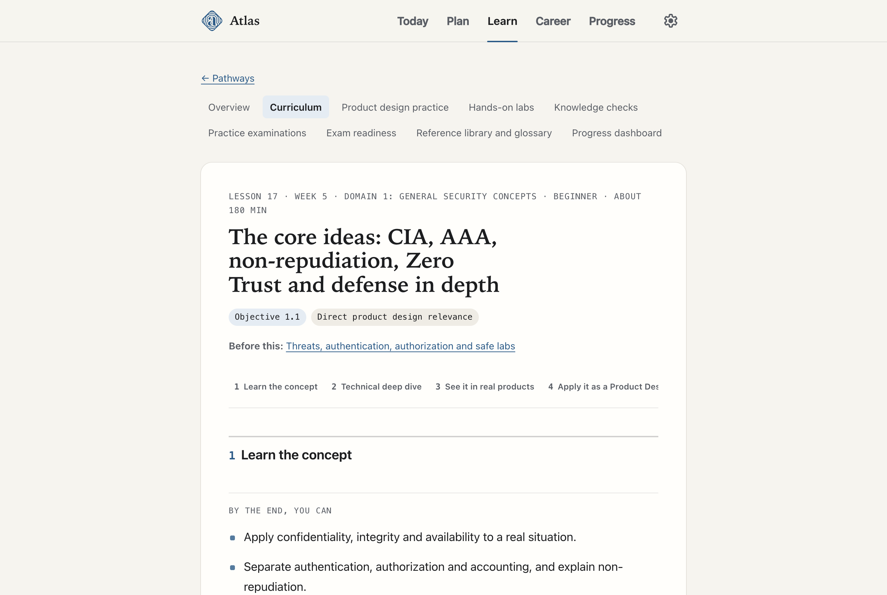
</p>

> **Independent and AI-written.** Atlas is not affiliated with, approved by or endorsed by CompTIA. The lessons, design briefs and practice questions were written with an AI model and are not actual exam questions. CompTIA says it does not authorize AI-generated study questions or practice exams, so read [its policy](https://www.comptia.org/en/resources/test-policies/unauthorized-training-materials/) and decide for yourself. This pathway does not replace security engineers or independently certify security work, and its design ratings are self-assessed.

### AI Security

Six self-paced lessons on trust boundaries in AI systems, direct and indirect prompt injection, data exposure through retrieval and memory, excessive agency and tool permissions, supply chain, output handling, monitoring and incident response. It ends with a tested agent permission and approval prototype.

## Private by design

- **No accounts and no tracking.** Everything you do stays in your own browser.
- **Works offline** and can be installed on a phone or computer like an app.
- **Export and import** your data as a file whenever you like.
- Course content arrives as checked content packs, added only when you select a pathway or ask for an update.
- Choosing, switching or leaving a pathway never changes your saved lesson progress.

## Built with

Plain HTML, CSS and JavaScript modules, with no frameworks, no dependencies and no build step. Icons are [Material Symbols Rounded](https://fonts.google.com/icons) by Google (Apache License 2.0), built in so nothing is fetched from other sites.

To run it on your own computer, serve this folder with any static web server, for example:

```bash
python3 -m http.server 8000
```

Then open http://localhost:8000.

## About

Designed and built by **Marva Abouei**, product designer.

© 2026 Marva Abouei. All rights reserved.
