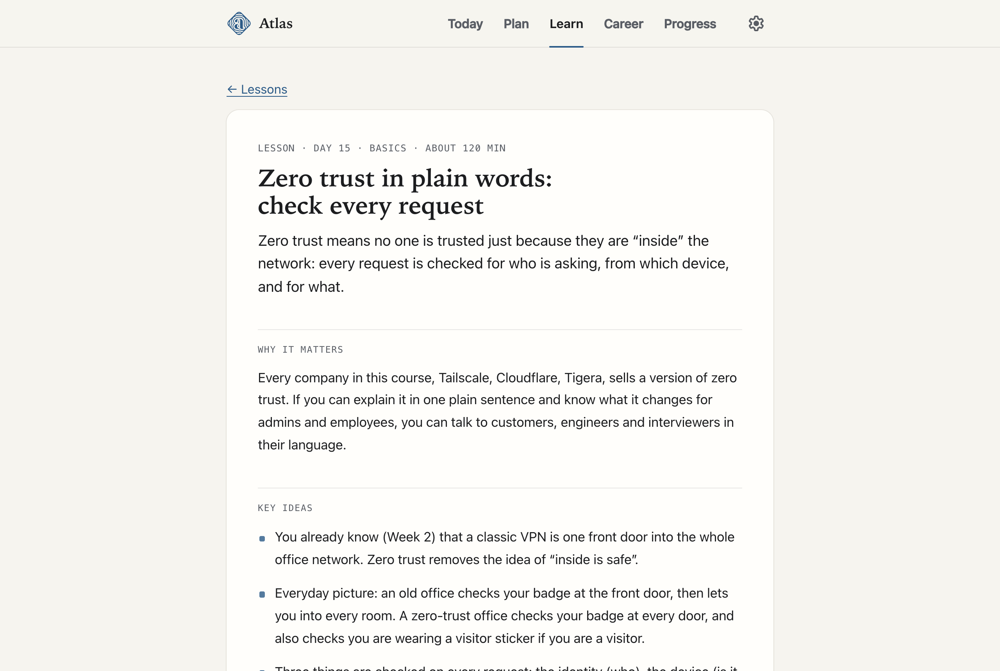

<p align="center">
  
</p>

<h1 align="center">Atlas</h1>

<p align="center">
  A 60-day course for product designers moving into identity and network security.<br>
  A lesson for every study day, hands-on exercises, and two portfolio case studies.
</p>

<p align="center">
  <a href="https://marva-a.github.io/atlas/"><strong>Open Atlas</strong></a>
</p>

<p align="center">
  
</p>

## What it is

Atlas is a self-paced study coach for one specific career move: becoming a senior product designer at a company that builds identity, network access or cloud security products, such as Tailscale or Tigera.

It starts from the basics in plain language with everyday examples, then climbs to intermediate and advanced topics. Every lesson is labelled **Basics**, **Intermediate** or **Advanced**, and the level only goes up.

## The course

Atlas is a product-design learning platform for security: a 60-day core course that starts with security foundations and builds a particularly strong identity and access (IAM) pathway, plus focused pathways you take at your own pace.

### The 60-day core

| Week | Topic |
| --- | --- |
| 1 | Identity basics and the people you design for, with security foundations: what security protects, risk decisions, controls and safe defaults |
| 2 | How networks work, explained for designers, with security foundations: clients, servers and APIs, protecting data, application security, a threat model |
| 3 | Zero trust and identity-based access |
| 4 | Sign-in, SSO and accounts at work |
| 5 | Containers and Kubernetes security |
| 6 | Seeing and responding: logs, alerts and incidents |
| 7 | Enterprise trust: least privilege, governance and policy as code |
| 8 | Machine identities, AI agents and designing for safety |
| 9 | Capstone: two case studies and your story |

- **52 lessons**, one for each study day, each with a measurable "by the end, you can" objective, key ideas, key terms, timed steps, and check-yourself questions with example answers. Security foundations are built into the Week 1–2 lessons that rely on them, so those weeks run longer than later ones.
- **17 designer exercises**: teardowns, flows, research, tabletop incidents and prototypes, using real tools such as Tailscale, Keycloak, Kubernetes and Calico.
- **Two portfolio case studies**: an access policy editor that shows who can reach what before a change goes live, and a Kubernetes flow from observed traffic to a recommended policy, staged before it is enforced.
- **Over 170 references** from primary sources (Kubernetes, Calico, Tailscale, NIST, OWASP, CISA, MITRE, Nielsen Norman Group and others). Every link is opened and checked before it is added.
- **Flashcards** with spaced repetition that unlock the day after their topic is taught.

### Pathways

Self-paced tracks beside the calendar, in Learn → Pathways, for going deeper in one area alongside the core or after it.

| Pathway | What it covers |
| --- | --- |
| **Network and Kubernetes Security** (10 calendar days) | Week 5 and the case study 2 days, grouped for learners targeting network, cloud and Kubernetes security products. Identity-focused learners can make these days optional. |
| **AI Security** (6 lessons) | Trust boundaries in AI systems, direct and indirect prompt injection, data exposure through retrieval and memory, excessive agency and tool permissions, supply chain, output handling, monitoring and incident response. Ends with a tested agent permission and approval prototype. |

<table>
  <tr>
    <td width="50%"></td>
    <td width="50%"></td>
  </tr>
  <tr>
    <td></td>
    <td align="center"></td>
  </tr>
</table>

## Private by design

- **No accounts and no tracking.** Everything you do stays in your own browser.
- **Works offline** and can be installed on a phone or computer like an app.
- **Export and import** your data as a file whenever you like.
- Course content arrives as checked content packs, and nothing is added until you confirm.

## Built with

Plain HTML, CSS and JavaScript modules, with no frameworks, no dependencies and no build step. Icons are [Material Symbols Rounded](https://fonts.google.com/icons) by Google (Apache License 2.0), built in so nothing is fetched from other sites.

To run it on your own computer, serve this folder with any static web server, for example:

```bash
python3 -m http.server 8000
```

Then open http://localhost:8000.

## About

Designed and built by **Marva Abouei**, product designer.

© 2026 Marva Abouei. All rights reserved.
